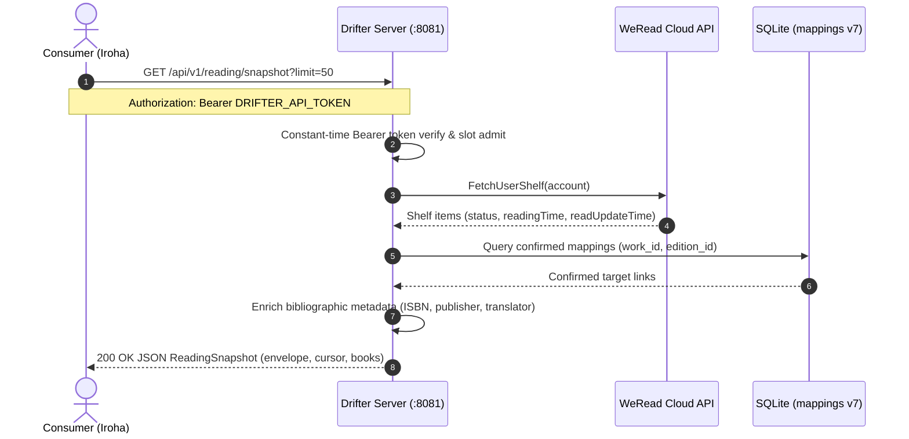
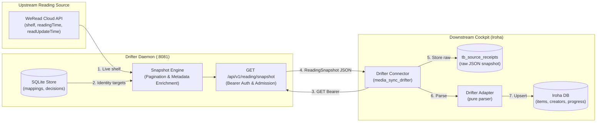

# HTTP server

The separate `drifter-server` executable starts without provider credentials.
It reads `WEREAD_API_KEY` and `HARDCOVER_API_KEY` from the runtime environment
only when needed. Configuration is strict settings-only TOML; keep secrets out
of TOML files.

## Container on Linux

Compose uses host networking so strict Host/Origin checks see the same
`127.0.0.1:8081` authority as the browser. There is deliberately no `ports`
mapping: the example config binds only to `127.0.0.1`, and wildcard listening
is not supported. Host networking gives the container direct access to the
Linux host network namespace; use it only on a trusted local host. Docker
Desktop's host networking behavior differs and is not the target of this setup.

The example TOML is bind-mounted read-only with a private SELinux label. Replace
its source with your own settings-only TOML if needed; do not put credentials in
it. State uses a Compose-managed named volume. On first use, the engine copies
the image's pre-created `/var/lib/drifter` directory into that empty volume;
it is owned by uid/gid `10001` with mode `0700`. The database and owner lock are
created mode `0600`, and the volume persists across restarts and ordinary
`compose down`. Use `compose down --volumes` only when intentionally deleting
that local state.

Build the image and export provider credentials in the current shell only if
provider requests are needed. Startup itself needs neither key:

```sh
podman build -f Containerfile -t drifter-server:local .
```

On Linux, start with `podman compose --env-file /dev/null up -d` or
`docker compose --env-file /dev/null up --build -d`. `/dev/null` prevents
Compose from loading a local `.env`; provider variables come only from the
shell environment. Do not commit credentials or a `.env` file.

On a Podman machine, the external Compose provider may need its API socket. Set
it in the shell, then run the same Podman Compose command:

```sh
export DOCKER_HOST="unix://$(podman machine inspect --format '{{.ConnectionInfo.PodmanSocket.Path}}')"
podman compose --env-file /dev/null up -d
```

That machine's host network namespace is the Linux VM's, not macOS's; this is
not evidence that macOS can reach the loopback listener. On Linux, test access
from the Linux host. Compose sends SIGTERM and allows 30 seconds for graceful
shutdown. Stop with Ctrl-C or `podman compose down` / `docker compose down`.

## Host allowlisting and tailnet preview

By default, the server enforces strict loopback Host header checks (`127.0.0.1`
and `localhost`). When serving behind a private Tailscale node or local reverse
proxy, pass explicit allowed hosts:

```sh
bin/drifter-server -allowed-hosts 'harus-macmini.talpidae-beta.ts.net:9441'
```

Or configure `allowed_hosts` in `config.toml`:

```toml
[server]
addr = "127.0.0.1:8081"
allowed_hosts = ["harus-macmini.talpidae-beta.ts.net:9441"]
```

## Mapping interface

The web interface at `/` is a zero-script, server-rendered admin dashboard
structured with CSS-only navigation tabs:

- **Mappings**: view confirmed links with proportional layout and unlinking.
- **Pending worklist**: review recently opened WeRead books and inspect candidates.
- **Confirm a mapping**: manually link a WeRead book ID to a target work/edition.
- **Export**: download the current mapping state as JSON (`/api/export`).
- **Sync**: inspect recent reconciliation runs, baselines, and active holds.

## Reading snapshot API

`GET /api/v1/reading/snapshot` serves one page of provider-neutral reading
facts for an account pair, so another service can ingest the shelf without
reading Drifter's SQLite state. It is read-only: it opens the mapping database
read-only and never writes provider status.





The endpoint requires a Bearer credential supplied at runtime:

```sh
curl --fail-with-body \
  -H "Authorization: Bearer $DRIFTER_API_TOKEN" \
  'http://127.0.0.1:8081/api/v1/reading/snapshot?limit=50'
```

`DRIFTER_API_TOKEN` is read from the environment; there is no TOML setting and
no built-in default. When it is unset, every snapshot request is rejected with
`401 {"error":"unauthorized"}` rather than serving reading facts without
authentication. The credential is compared in constant time and is never
logged.

Query parameters are optional:

| Parameter | Meaning |
| --- | --- |
| `account` | Source account namespace; when omitted, the bound source account is used. |
| `target_account` | Target account namespace whose confirmed mappings are attached; when omitted, the bound target account is used. |
| `limit` | Page size, clamped to 1–100; defaults to 50. |
| `cursor` | Opaque token from the previous page's `cursor` field. |

Unknown or repeated parameters are rejected with `400`. No query requires
`account=default`: an account label is a local namespace, and the export
reports the provider identity actually bound behind it.

The response carries `version` (`1.0`), `generated_at`, `source_identity`
(e.g. `weread:23849102`), optional `target_identity` (e.g. `hardcover:4821`),
`watermark` (the RFC3339 instant to send back as `since`), `has_more`, the next
`cursor` while `has_more` is true, and `books`. An identity is reported only
when the store or the live provider confirms it; it stays empty rather than
echoing a local label. Books are ordered by last open time, then source
identity. Each book carries its own provider identity
(`source_provider`, `source_book_id`, `title`, `author`), optional catalog
metadata (`translator`, `publisher`, `isbn`, `cover_url`, `reader_url`),
progress (`status` of `completed`, `reading` or `planned`, `progress_percent`,
`reading_time_seconds`, `last_read_at`, `finished_at`), `is_custom` for `CB_...`
uploads, and `matched_target` when a confirmed mapping exists.

Facts the source does not report stay absent: `started_on` is always omitted
because WeRead reports no true start instant or start day, and
`reading_time_seconds`, `last_read_at` and `finished_at` are omitted when the
source has no such fact. Reading time is cumulative, never a session interval.

Errors use the JSON error shape: `401 unauthorized`, `400
invalid_snapshot_query`, `400 invalid_cursor`, `503 provider_unavailable`,
`provider_operation_busy` or `mapping_database_unavailable`, `502
snapshot_failed`, and `504 operation_timeout`.

## Reading changes API

`GET /api/v1/reading/changes` serves only the shelf facts that changed at or
after the caller's watermark, so a consumer follows the shelf without
re-reading every page. It requires the same Bearer credential and admission as
the snapshot route and reads state read-only.

```sh
curl --fail-with-body \
  -H "Authorization: Bearer $DRIFTER_API_TOKEN" \
  'http://127.0.0.1:8081/api/v1/reading/changes?since=2026-11-11T09:00:00Z'
```

| Parameter | Meaning |
| --- | --- |
| `since` | Required watermark: RFC3339 (e.g. `2026-11-11T09:00:00Z`) or a unix second count. |
| `account`, `target_account` | Optional namespaces, resolved as for the snapshot route. |
| `limit` | Page size, clamped to 1–100; defaults to 50. |
| `cursor` | Opaque token from the previous delta page. |

A book is a change when either the source reports a read instant at or after
`since`, or its confirmed mapping was created or updated then — so a re-link
is visible even when nothing was read. The response is the snapshot envelope,
with `watermark` set to the latest observed change instant and never earlier
than `generated_at`, plus only the changed books on that page. Send that
`watermark` back as the next `since`.

A watermark may trail by at most 14 days. An older or missing horizon is not
answered with a partial delta:

```json
{
  "error": "horizon_exceeded",
  "message": "watermark is older than 14 days; full snapshot required",
  "snapshot_required": true
}
```

That response is `410 Gone`, sent before any provider call, and tells the
consumer to re-read `/api/v1/reading/snapshot` and adopt its `watermark`.
Other errors match the snapshot contract, with `400 invalid_changes_query` for
a missing, repeated or unparseable `since`, parameter or limit.

## Rootless runtime verification

Verified with Podman 5.8.7 on the macOS-hosted Linux/arm64 VM (`rootless=true`,
SELinux `Enforcing`). The Compose smoke used a unique project, temporary
credential-free TOML (`server.addr = "127.0.0.1:0"`) and the existing local
image. A temporary override replaced only the config bind source; it used the
same read-only mount and private SELinux label. The tested invocation was:

```sh
socket=$(podman machine inspect --format '{{.ConnectionInfo.PodmanSocket.Path}}')
env -u WEREAD_API_KEY -u HARDCOVER_API_KEY \
  DOCKER_HOST="unix://$socket" \
  podman compose --env-file /dev/null -p drifter-rootless-smoke \
  -f compose.yaml -f "$temporary_override" up -d --no-build --pull never
```

The temporary override mounted its TOML read-only with `bind.selinux: Z`;
SELinux relabeling fixed the earlier rootless bind-read denial. The named state
volume was copied from the image directory and had mode `0700`, uid/gid
`10001:10001`; the database and owner lock were mode `0600`. All four
credential-free GETs (`/healthz`, `/readyz`, `/`, `/api/mappings`) returned
200; mappings were `[]`. A concurrent server using that DB was refused as
owned/locked. Compose SIGTERM stop exited 0; starting the same service again
returned ready and mappings successfully, with the DB inode, size, mode and
owner unchanged. The volume and temporary config were removed with that unique
project's `compose down --volumes`; no images were pruned.

The probe helper joined the server container's network namespace, so these
results test the Linux VM's loopback only. Rootless verification did not test
macOS reachability or a rootful Docker engine.

The full Compose lifecycle smoke above predates extraction of the startup runner
into `internal/server`. After that source change, the focused runner test,
current image rebuild and image help check passed:

```sh
go test ./internal/server -count=1
podman build -f Containerfile -t drifter-server:local .
env -u WEREAD_API_KEY -u HARDCOVER_API_KEY \
  podman run --rm --pull=never drifter-server:local --help
```

The runner test covers help, sanitized parse errors, no-credential startup,
health, shutdown and `database.path` precedence. The full Compose lifecycle was
not repeated; its earlier results apply to the unchanged Compose/volume/network
configuration, while current runner behavior is evidenced by the Go tests.

These owning gates passed:

```sh
make check
mise exec -- rumdl check README.md docs/architecture.md docs/cli.md \
  docs/plans/http-server.md docs/plans/matching-worklist.md \
  docs/plans/matching-catalogs.md docs/plans/read-only-matching.md \
  docs/walkthroughs/README.md docs/server.md
make e2e-probe ROUTE=/
make e2e
git diff --check
```
